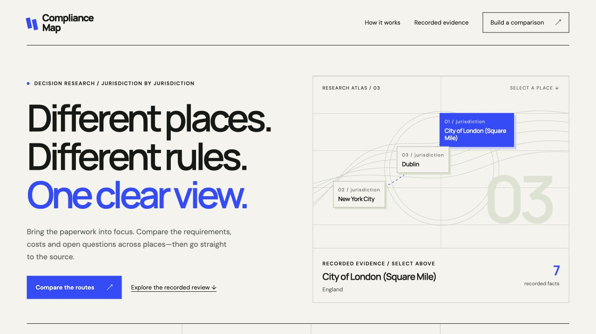

# Compliance Map

Compare the paperwork for starting the same business in several places. Compliance Map puts official requirements, scoped costs, timing, renewals and ongoing filings side by side, then explains where to begin due diligence and what still needs an answer.

The included demonstration follows a small café and a home-based software consultancy through the City of London, New York City and Dublin. It uses a genuine saved TinyResearch investigation, followed by exact-page retrieval and local field review. The preview runs without an API key and starts no new research.



[Watch the 96-second walkthrough](compliance-map/docs/media/compliance-map-demo.mp4) · [Captions](compliance-map/docs/media/compliance-map-demo.srt)

## Run it locally

Use **Node.js 22 or newer** and Git for the clone command. Clone the public repository, then install and run:

```sh
git clone https://github.com/himanshu748/compliance-map.git
cd compliance-map
npm ci
npm start
```

Open [Compliance Map](http://127.0.0.1:4390). The server binds to `127.0.0.1:4390` and starts with fresh research disabled. It serves the report and its fonts locally. Dependency installation requires npm registry access; opening a government source link requires internet access.

You should see both recorded activity tabs, the three places, an aligned comparison and expandable source details. Switch activities, filter the details, read a recommendation and export JSON. Preparing a different activity/place brief changes the proposed request; it does not change the recorded evidence or start a provider job.

To use another port:

```sh
COMPLIANCE_MAP_PORT=4391 npm start
```

The [judge guide](compliance-map/docs/JUDGE_GUIDE.md) gives a five-minute review path and maps the bounty requirements to evidence. The [demo sequence](compliance-map/docs/DEMO.md) provides a short walkthrough plan for both activities.

## The recorded comparison

One TinyResearch Deep run completed on **8 November 2026** and investigated both activities across all three places. Local review retained **31 requirements** and withheld **2 unsupported requirements**.

| Activity                        | City of London          | New York City           | Dublin                  |
| ------------------------------- | ----------------------- | ----------------------- | ----------------------- |
| Small café                      | 7 reviewed requirements | 7 reviewed requirements | 5 reviewed requirements |
| Home-based software consultancy | 5 reviewed requirements | 3 reviewed requirements | 4 reviewed requirements |

The café scope excludes alcohol, outdoor seating, late-night service, frozen desserts and wholesale supply. The consultancy assumes a sole trader working from home, with no employees or regulated financial or medical advice. Different premises, services or personal circumstances require further checks.

The café recommendation identifies a scoped advantage in the reviewed food-registration charge for the City of London and Dublin. The consultancy recommendation follows an affirmative rule about registration sequence in the City of London. Neither recommendation establishes the cheapest, fastest or easiest place overall. Each includes its supporting requirements, conditions and trade-offs.

The two withheld requirements concern NYC home-occupation zoning and Dublin home-premises rules. Their original citations did not support those claims, so they remain open questions.

## How the evidence becomes a decision

1. **Frame one comparable request.** The typed boundary accepts one to three activities and three to six distinct places. Scope and exclusions travel with the query. All requested activity/place identities must match the returned result.
2. **Investigate with TinyResearch.** One batched Deep request researches official requirements across the complete input. Parsing checks source ownership patterns, provider citations, dates, fee quantities and timing language. A notice deadline and an approval estimate remain different facts.
3. **Check the exact pages.** A separate bounded TinyFish Fetch audit retrieved 35 official pages. Local review checked the retained fields, their meaning and applicability against those saved observations. A source text match alone does not establish a correct legal interpretation. NYC’s annual permit-fee frequency also retains a separate, dated ordinary-HTTPS source check; it is identified separately from those 35 Fetch observations.
4. **Compare equivalent dimensions.** The decision layer aligns licences, filings, tax, premises, training, costs, timing, renewals and ongoing filings. It groups known amounts by currency and payment period, separates required, conditional and optional obligations, and leaves unselected alternatives unsummed.
5. **Explain a scoped next step.** A recommendation names the supported advantage and its conditions. Unknown rules elsewhere remain unknown; the comparison does not infer a prohibition or permission from missing evidence.

TinyResearch performs the investigation. Fetch supplies exact-page observations for corroboration. Replaying the report or deriving a decision from those observations makes no new provider request.

The original Research run ID is `01a1ba34-7c95-7888-8787-ebfedb8187fb`. Public metadata retains the original receipt digest and separates the provider result from later local review. Raw provider receipts, source captures and credentials stay private. Exported quotations are limited to 25 words per canonical source page across the report; shortened or withheld excerpts keep their provenance metadata.

## Inspect the proof

| Artifact                                                                    | What it contains                                                                                              |
| --------------------------------------------------------------------------- | ------------------------------------------------------------------------------------------------------------- |
| [Reviewed report](compliance-map/evidence/qualified-batch-report.json)      | Both activities, retained requirements, official links, checked dates, applicability, conditions and unknowns |
| [Decision export](compliance-map/evidence/qualified-batch-decision.json)    | Aligned dimensions, scoped subtotals, timing milestones, recommendations and trade-offs                       |
| [Review metadata](compliance-map/evidence/qualified-batch-metadata.json)    | Original receipt and review digests, coverage, retained/withheld counts and derivation provenance             |
| [Official-source audit](compliance-map/evidence/official-source-audit.json) | Exact retrieval outcomes, including the failed request and the absence of automatic retries                   |
| [Backend validation](compliance-map/evidence/qualified-validation.json)     | Dated checks and the precise boundary they establish                                                          |

The source audit attempted 36 one-URL requests. The last response could not be validated, so that source remains uncorroborated and the shared pool halted. No automatic retry followed. Fetching a page, reviewing a field and proving legal completeness are separate outcomes.

## Limits that stay visible

Complete setup costs and end-to-end approval times remain unknown. A known subtotal covers only its cited obligations, currency and payment period. Missing amounts are not zero, alternative filing routes are not cumulative fees, and tax liabilities are not fixed registration charges.

Address-specific planning, premises suitability, personal eligibility and changes after the checked date can affect the result. Use the official links and confirm applicability with the relevant authorities before acting. This build researches obligations; it does not check whether a person or business already holds a licence.

The saved live demonstration covers the two activities and three places listed above. The generic input and query path support other scopes, but editing a brief in the preview does not establish a newly researched result.

## Fresh research and server boundaries

Fresh research is disabled by default. An operator must provide a reviewed external authorization grant, its existing durable shared ledger and an explicit private credential-file reference before enabling the live path. The release includes no usable key or new spending authorization. An exhausted or halted pool must remain blocked until a separately authorized recovery or new allowance is established.

For an authorized request, the server accepts a strict activity/place batch and UUID at `POST /api/compliance-map/v2`, starts one Deep run, persists private acceptance and outcome receipts, and connects a client disconnect to cancellation handling. It makes no automatic job retry and never substitutes recorded evidence after a live failure. Successful fresh reports use temporary same-origin `/reports/<UUID>.html` routes.

The server enforces loopback Host checks, same-origin POST requests, a 32KB JSON limit and CSP hashes for its inline scripts and styles. It serves no remote CORS API. `GET /health` reports the configured mode; it does not claim provider or ledger health. `GET /evidence/report.json` exposes only validated public report fields.

An operator can select a different reviewed artifact with an absolute `COMPLIANCE_RECORDED_REPORT` path. A missing or invalid override fails closed. Private live outputs use owner-only directories and files; credentials and raw receipts are never HTTP routes.

## Verification

The [release checks](compliance-map/docs/VERIFICATION.md) record the clean-package tests, in-app browser review and successful anonymous public-clone verification. The [submission packet](compliance-map/docs/SUBMISSION.md) links the published LinkedIn and X video posts. The earlier LinkedIn post was removed at the owner’s request; the replacement was published on 9 November 2026. The required Discord showcase share is also published. The claimed entry is [ready for submission](compliance-map/evidence/release/pre-submission-check.json), with its actual form prepared; final submission remains pending.

## Development checks

```sh
npm test
npm run typecheck
npm run build
```

Tests cover input and citation validation, quantity support, semantic-review requirements, decision arithmetic, conditional costs, alternative routes, HTML escaping and the standalone HTTP boundary. Provider lifecycle tests use synthetic fixtures or injected offline transports. Passing them does not establish a new provider execution; the linked recorded artifacts establish the saved live demonstration.

The main implementation is in [general.ts](compliance-map/src/general.ts), [audit.ts](compliance-map/src/audit.ts), [decision.ts](compliance-map/src/decision.ts) and [server.ts](compliance-map/src/server.ts). The interface lives under [compliance-map/web](compliance-map/web).

The [submission packet](compliance-map/docs/SUBMISSION.md) contains the product description and prepared promotion copy. A working local build, public publication, required community sharing and bounty approval remain separate states.
